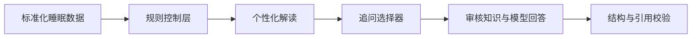

# 眠知 · AI 睡眠助手

> 基于个人近期基线的可穿戴睡眠解读 Demo：先由规则层判断变化，再通过审核知识约束大模型回答。

[](https://www.python.org/)
[](https://streamlit.io/)
[](#评测结果)

## 项目简介

Apple Watch 等可穿戴设备能够提供深睡、REM、核心睡眠和夜间清醒等数据，但普通用户很难判断：一个阶段偏高或偏低是否真的重要、单晚变化是否值得担心，以及应该继续观察什么。

本项目以“深睡指标卡”为 MVP，围绕三个目标设计：

1. 用用户自己的近期数据建立个人基线，而不是只套用统一参考比例；
2. 区分单晚波动和近期重复变化，避免把一个数字直接解释成睡眠质量；
3. 将事实判断、推荐追问和知识回答拆开，降低通用大模型过度推断的风险。

公开 Demo 使用已经通过阿里云百炼 `qwen3.7-plus` 真实接口验收的脱敏测试输出，因此不会暴露 API Key，也不会因公开访问产生模型调用费用。

## 在线体验

部署完成后，请将 Streamlit 地址填写在这里：

```text
https://YOUR-APP-NAME.streamlit.app
```

## 核心交互

Demo 支持切换四种睡眠场景：

| 场景 | 系统行为 | 推荐问题 |
|---|---|---|
| 日常正常波动 | 解释当前水平位于个人典型范围 | DS01：深睡是不是越多越好？ |
| 单晚明显偏低 | 区分单晚变化与稳定趋势 | DS21：单晚偏低为什么不一定代表睡眠质量变差？ |
| 近期重复偏低 | 提示重复变化值得观察，同时保持判断边界 | DS15：近期多次偏低是否说明睡眠质量变差？ |
| 时长低、占比正常 | 信息不足时不强行推荐问题 | `null` |

页面包含：

- 昨晚深睡时长与占比；
- 近 14 天个人典型范围；
- AI 个性化解读；
- 推荐追问与点击展开回答；
- 始终可见的自由提问入口；
- 深睡时长与占比各自的动态个人区间位置；
- 产品架构、模型评测与边界说明。

自由问答状态按场景隔离：切换案例不会把上一场景的问答误显示为当前结果。回答会明确标注“审核知识回答”“当前场景数据 + 审核知识”或“超出当前 MVP 范围”，避免把本地演示包装成已经上线的开放式 AI 问答。

## 系统架构



### 模块分工

| 模块 | 负责内容 | 不负责内容 |
|---|---|---|
| 规则控制层 | 个人基线、区间位置、偏离程度、重复变化 | 不生成开放式医学结论 |
| 个性化解读 Prompt | 将已确认事实转成用户文案 | 不重新计算规则事实 |
| 追问选择器 | 固定选择 DS01、DS21、DS15 或 `null` | 不让模型自由创造推荐问题 |
| 审核知识库 | 提供回答依据与安全边界 | 不替代个人数据判断 |
| 回答模型 | 组织自然、易懂的中文回答 | 不诊断、不推断未提供原因 |
| 输出校验 | 检查问题、知识引用与证据引用 | 不修饰模型回答 |

推荐追问和自由提问同时存在：推荐追问负责降低提问门槛，自由提问负责承接用户主动探索。公开作品集版以本地审核知识演示自由问答，不把访客输入发送到线上模型；正式版本计划通过版本化 RAG 检索知识并增加回答评测。

## 为什么不直接使用通用大模型

通用大模型可以生成流畅的单晚解读，但在睡眠场景中可能出现：

- 将某个固定阶段比例当作所有人的理想目标；
- 根据一晚数据推断压力、疾病或生活习惯；
- 忽略可穿戴设备的估算属性；
- 每次回答口径不一致；
- 无法稳定利用用户的长期趋势。

本项目通过“规则层事实 + 固定追问映射 + 审核知识 + 输出校验”控制这些风险，让模型专注于表达，而不是独立决定医学事实。

## 评测结果

真实模型：`qwen3.7-plus`  
端到端版本：`SLEEP-END-TO-END-V1.1`

| 案例 | 预期追问 | 实际追问 | 回答要求 | 结果 |
|---|---|---|---|---|
| P01 | DS01 | DS01 | 深睡并非越多越好；补充整体睡眠维度 | 通过 |
| P03 | DS21 | DS21 | 单晚波动、设备估算、整体睡眠维度 | 通过 |
| P04 | DS15 | DS15 | 重复变化值得观察，但不能直接下结论 | 通过 |
| P05 | `null` | `null` | 不生成推荐追问和回答 | 通过 |

结果：**4/4 通过**。

## 本地运行

### 1. 创建虚拟环境

```bash
python3 -m venv .venv
source .venv/bin/activate
```

### 2. 安装依赖

```bash
pip install -r requirements.txt
```

### 3. 启动 Demo

```bash
streamlit run streamlit_app.py
```

浏览器通常会自动打开 `http://localhost:8501`。

### 4. 运行数据测试

```bash
python -m unittest discover -s tests -v
```

## 部署到 Streamlit Community Cloud

1. 将本项目推送到 GitHub；
2. 登录 [Streamlit Community Cloud](https://share.streamlit.io/)；
3. 使用 GitHub 账号授权；
4. 选择本仓库；
5. 入口文件填写 `streamlit_app.py`；
6. 点击 Deploy；
7. 将生成的公开链接填回 README 的“在线体验”。

当前公开版本不需要配置任何 Secrets。

## 项目结构

```text
ai-sleep-assistant-demo/
├── streamlit_app.py             # 作品集 Demo 页面
├── backend/                     # 冻结的 V1.1 后端链路
├── data/                        # 4 份脱敏真实模型验收结果
├── tests/test_demo_data.py      # Demo 数据与映射回归测试
├── .streamlit/config.toml       # 页面主题
├── requirements.txt
├── .gitignore
├── LICENSE
└── README.md
```

## 产品边界

- 当前 MVP 只覆盖深睡指标；
- 可穿戴设备数据适合观察记录和趋势，不能等同于医院多导睡眠监测；
- 本项目不提供疾病诊断或治疗建议；
- 当前 Demo 未直接读取 Apple Health 数据；正式 iOS 产品需要通过 HealthKit 获取用户授权；
- 自由提问目前是基于审核知识的本地演示，不代表开放域医疗问答；
- 测试结果证明冻结场景通过，不代表所有真实世界输入已经覆盖。

## 后续规划

- 扩展 REM 与夜间清醒指标卡；
- 增加缺失数据、极端值与冲突信息测试；
- 为自由提问接入版本化 RAG 与专门评测集；
- 通过 iOS HealthKit 接入授权数据；
- 开展用户可理解性与信任度测试；
- 建立版本化评测集，持续比较模型与 Prompt 变更。

---

本项目为 AI 产品作品集 Demo，重点展示需求拆解、规则与模型分工、知识约束、端到端实现和评测闭环。
